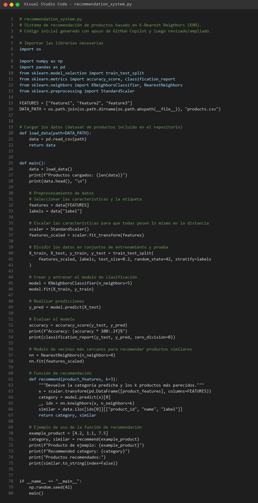
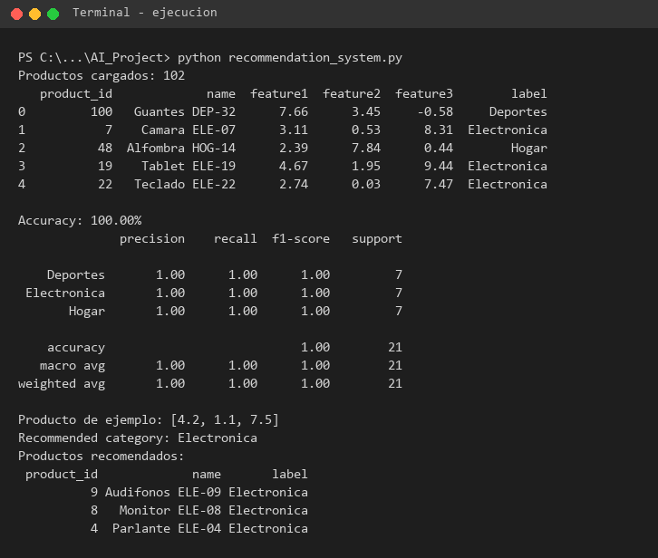

# AI_Project – Sistema de recomendación con GitHub Copilot

Actividad formativa **ETDI02 – Unidad 3 – Semana 14: GitHub Copilot** (INACAP).

El objetivo es explorar las tendencias emergentes en inteligencia artificial usando **GitHub Copilot** como asistente de programación, creando un pequeño **sistema de recomendación de productos** en Python con aprendizaje automático (K-Nearest Neighbors).

---

## Contenido del repositorio

| Archivo | Descripción |
|---|---|
| `recommendation_system.py` | Sistema de recomendación: entrena un clasificador KNN y recomienda productos similares. |
| `products.csv` | Dataset de ejemplo con 102 productos (3 características numéricas + categoría). |
| `requirements.txt` | Librerías de Python necesarias. |
| `.gitignore` | Archivos que Git no debe versionar. |
| `LICENSE` | Licencia MIT. |
| `screenshots/` | Capturas del código y de la ejecución. |

---

## Proceso seguido (paso a paso)

### 1. Ingreso a GitHub
Se ingresó al sitio <https://github.com/> y se inició sesión con la cuenta personal.

### 2. Cuenta de estudiante y GitHub Copilot
Se solicitó el beneficio de estudiante (GitHub Education) y se activó **GitHub Copilot**. En la sección *Pricing* se eligió el plan **Gratis (Free)**, que incluye Copilot Free.

### 3. Validación del correo e ingreso a la cuenta
Se registró el correo electrónico, se validó con el código enviado y se ingresó al *Dashboard*.

### 4. Creación del repositorio
Desde el *Dashboard* → **New**:
- **Nombre:** `AI_Project`
- **Visibilidad:** Público (para que el docente pueda revisarlo)
- Se agregó `README`, `.gitignore` (Python) y licencia **MIT**.
- Clic en **Create repository**.

### 5. Clonar el repositorio en Visual Studio Code
En la terminal integrada de VS Code:

```bash
git clone https://github.com/sebastianconstant226-sketch/AI_Project.git
cd AI_Project
```

### 6. Crear el archivo con GitHub Copilot
Se creó el archivo `recommendation_system.py`. Escribiendo comentarios descriptivos como:

```python
# Importar las librerías necesarias
# Cargar los datos (ejemplo: dataset de productos)
# Dividir los datos en conjuntos de entrenamiento y prueba
# Crear y entrenar el modelo
# Función de recomendación
```

GitHub Copilot fue sugiriendo el código de cada bloque (importaciones, carga de datos con pandas, `train_test_split`, `KNeighborsClassifier`, etc.), y las sugerencias se aceptaron con `Tab`.

Luego el código se revisó y mejoró manualmente:
- Se agregó **escalado** de características con `StandardScaler`.
- Se usó `stratify` para dividir los datos de forma balanceada.
- Se añadió `NearestNeighbors` para que la función `recommend()` no solo prediga la categoría, sino que devuelva los **3 productos más parecidos**.
- Se creó el dataset `products.csv` para que el programa funcione sin descargar nada.



### 7. Ejecución

```bash
pip install -r requirements.txt
python recommendation_system.py
```

Resultado obtenido:



El modelo alcanza un **100 % de accuracy** en el conjunto de prueba (el dataset de ejemplo tiene categorías bien separadas) y, para el producto de ejemplo `[4.2, 1.1, 7.5]`, recomienda la categoría **Electronica** y tres productos similares.

### 8. Commit y Push a GitHub

```bash
git add .
git commit -m "Add recommendation system example"
git remote add origin https://github.com/sebastianconstant226-sketch/AI_Project.git   # solo si el repo se creó localmente
git push -u origin main
```

### 9. Entrega
El enlace del repositorio se pegó en un documento Word con los datos del estudiante y se subió al AAI.

---

## ¿Cómo funciona el sistema?

1. **Carga** `products.csv` (cada producto tiene `feature1`, `feature2`, `feature3` y una categoría `label`).
2. **Escala** las características para que todas pesen igual en el cálculo de distancias.
3. **Entrena** un `KNeighborsClassifier` (k = 5) con el 80 % de los datos y lo evalúa con el 20 % restante.
4. **Recomienda**: dado un producto nuevo, predice su categoría y busca los productos más cercanos en el espacio de características.

## Reflexión: GitHub Copilot y las tendencias de IA

GitHub Copilot es un ejemplo de **IA generativa aplicada al desarrollo de software**: un modelo de lenguaje entrenado con código que sugiere líneas o funciones completas a partir del contexto y de comentarios en lenguaje natural. En esta actividad permitió:

- Escribir el esqueleto del programa en minutos a partir de comentarios.
- Recordar la sintaxis de librerías como scikit-learn sin consultar la documentación constantemente.

Aun así, las sugerencias deben **revisarse**: el código inicial no escalaba los datos ni recomendaba productos concretos, y dependía de un CSV inexistente. El programador sigue siendo responsable de validar, probar y mejorar lo que propone la IA.

## Referencias

- GitHub. (s. f.). *GitHub Copilot Documentation*. <https://docs.github.com/en/copilot>
- GitHub. (s. f.). *Getting Started with GitHub Copilot*. <https://docs.github.com/en/copilot/getting-started-with-github-copilot>
